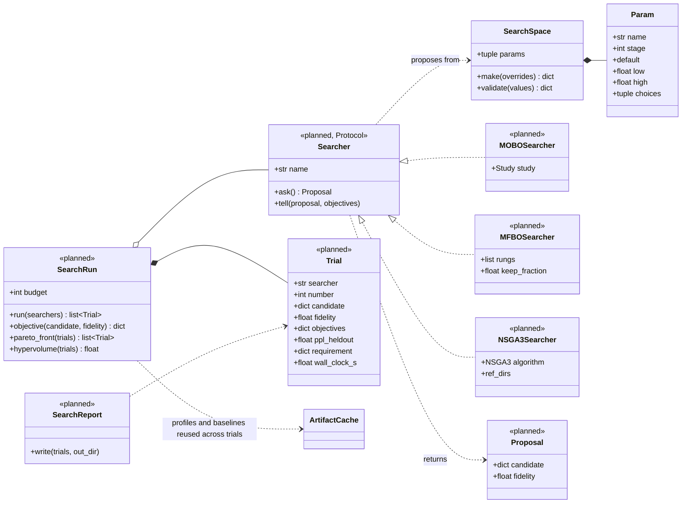
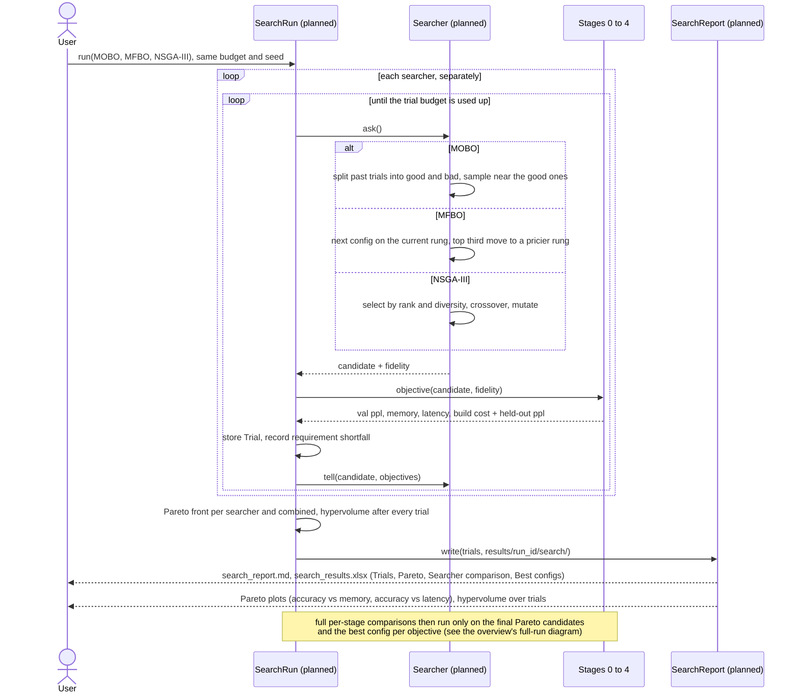

# Search layer

Back to the [overview](README.md).

## Current design (2026-10-25)

Written in `src/sdf/search.py` (MODE "search" in `main.py`). Mohammad, 2026-10-25: "the framework is sequential",
"stage 1 then 2 then 3 then see if its the best model".

1. A searcher (MOBO, then MFBO; NSGA-III is available) proposes a setting: the search-space numbers plus one
   technique per stage.
2. The try builds one chained model: Stage 0 plans it (the one-shot joint plan, no refinement:
   `SEARCH_REFINE_ROUNDS = 0`), then Stage 1 quantizes, Stage 2 prunes that model, Stage 3 compresses its KV cache.
3. Only that final model is judged: it must have validation perplexity at most 11.5 (`TARGET_PPL`), and the search
   makes it as small as it can (predicted size first in `SEARCH_OBJECTIVES`; no size limit, `TARGET_MEMORY_GB =
   None`; Mohammad, 2026-10-26: "lets see how much smaller can we get the model, while keeping 11 ppl or lower").
   The tries run on Hugging Face only; the smallest final model with perplexity at most 11.5 is then measured on the
   backends (Stage 4).
4. After the searchers: Stage 1 techniques in `SEARCH_EXTRA_STAGE1` (SpQR, QuIP, QuIP#) that no searcher built get
   one try each (the best setting with only its Stage 1 technique changed), and the final model with the lowest
   perplexity is tested for accuracy (`SEARCH_ACCURACY_TASKS`: ARC-Easy, PIQA, HellaSwag, WinoGrande, lm-eval) next
   to the uncompressed TinyLlama measured in the same run.

Outputs: `results/<run_id>/search/` with `search_report.md`, `search_results.xlsx`, `trials.json` and the plots.
MODE "stage_search" (each stage searched on its own, then combined) is kept in `src/sdf/stage_search.py` but is
not the design. The class and sequence diagrams below are the original plan and differ in names.

## In plain words

The framework has a handful of settings (how strict the "fragile layer" threshold is, how much to prune, how
many bits to keep, which calibration text to use, and so on). Each combination gives a different balance of
accuracy, memory, speed and build time, and no single one is best on all four. The search tries many
combinations and keeps the **Pareto front**: the ones that nothing else beats on every goal at once.

Three search strategies are compared, each with the same settings to choose from and the same number of tries:

- **MOBO** (Optuna) learns from past tries which regions look promising.
- **MFBO** (successive halving) tests many settings cheaply, then re-tests only the best third more carefully.
- **NSGA-III** (pymoo) evolves a population: it keeps good, varied settings and combines them into new ones.

Their results are kept separate and benchmarked: how fast each finds good settings and how much of the best
combined front it contributes.

## Class diagram

Objectives (all minimised): validation-half perplexity, memory, latency, build cost. Held-out perplexity is
stored on every `Trial` but never returned to a searcher. `SEARCH_SPACE` today holds `sensitive_threshold`,
`prune_ratio_aggressive`, `calib_dataset`, `calib_samples` and `gptq_groupsize`; `smoothquant_alpha` and
`quarot_k_bits` join it with Stages 2 and 3.

## Sequence diagram

